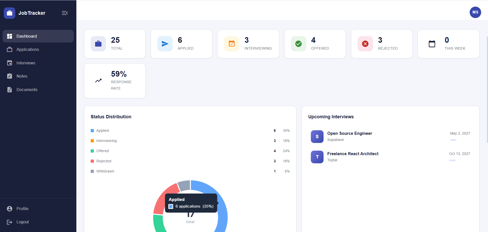
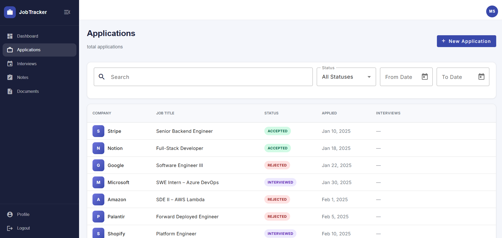
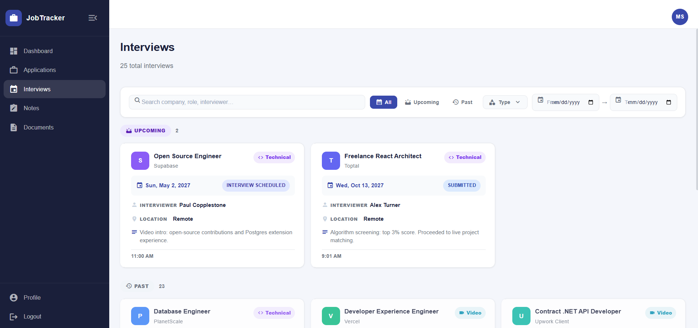
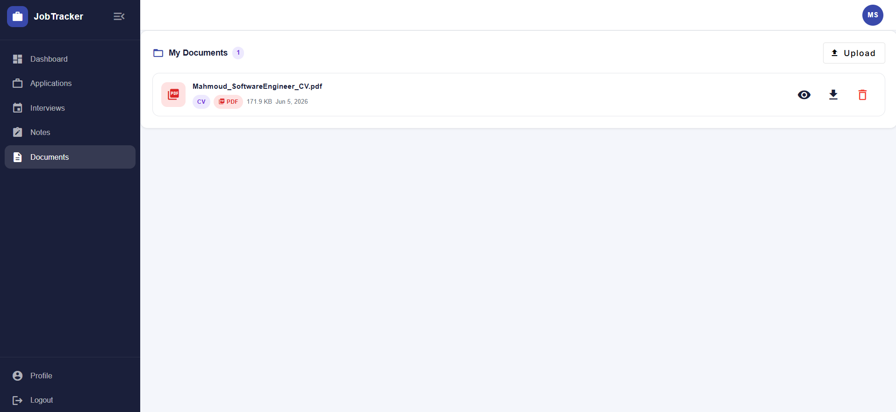
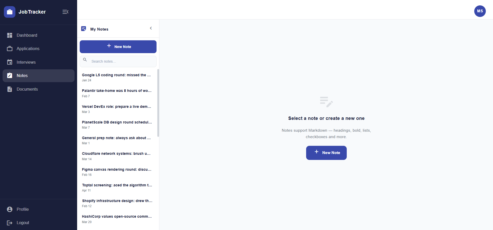
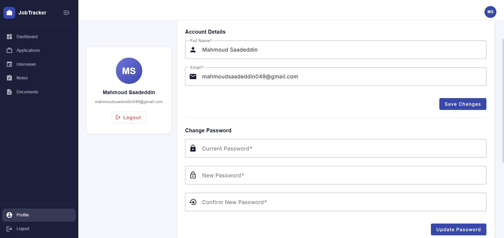

# JobTracker

> A focused, full-stack workspace for turning a job search into a clear, trackable process.

**Live application:** [jobapptracker.tryasp.net](https://jobapptracker.tryasp.net/dashboard)

JobTracker brings applications, interviews, notes, documents, dashboards, and AI-assisted job-posting analysis into one calm workspace. It is designed for the part of a job search that usually becomes scattered across browser tabs, spreadsheets, email threads, and forgotten reminders.



## Why this project stands out

- **Built around a real workflow:** capture a role, track its status, prepare for interviews, attach documents, and keep context in notes.
- **Useful automation:** parse job postings, compare a resume with a role, and generate cover-letter drafts with the integrated AI services.
- **Recruiter-friendly engineering:** a layered .NET backend, standalone Angular frontend, validation, authentication, database migrations, integration tests, and Docker deployment.
- **Fast capture from the web:** the companion Chrome/Edge extension can extract a job posting while browsing and save it to the signed-in JobTracker account.
- **Deliberate interface design:** compact cards, clear status language, responsive layouts, dark mode support, command palette navigation, and focused empty/loading states.

## Product capabilities

### Application management

- Create, edit, view, filter, sort, and delete job applications.
- Track statuses from `Draft` and `Submitted` through interviews, offers, rejection, and withdrawal.
- Record company, role, location, job type, work mode, application date, link, description, and required skills.
- Keep application details scoped to the authenticated user.

### Dashboard and decision support

- Total applications and weekly activity.
- Status breakdown and response-rate overview.
- Recent applications and upcoming interviews.
- Chart-based progress at a glance.

### Interview preparation

- Link interviews to applications.
- Record interview type, date, interviewer, notes, and feedback.
- Review upcoming conversations from the dedicated interview workspace.

### Notes and documents

- Keep searchable job-search notes in a focused editor workspace.
- Upload and manage resumes, cover letters, and other supporting documents.
- Use stored documents as inputs for AI-assisted resume matching and cover-letter generation.

### AI-assisted workflow

- Parse raw job-posting text into structured role data.
- Compare a selected resume against a job and surface matched and missing skills.
- Generate a tailored cover-letter draft with an adjustable tone.

### Browser extension

The standalone extension lives in [`jobtracker-extension/`](jobtracker-extension/README.md).

- Captures job title, company, location, description, and skills from job pages, with LinkedIn-aware extraction. Long descriptions are summarised to the requirements and responsibilities instead of being cut off.
- Opens as a Chrome/Edge toolbar popup and reads the page once, only when you click it, so browsing stays fast.
- Uses your JobTracker login on the website. The extension never asks for or stores a password.
- Clicking **Save to applications** saves directly to the signed-in account; if signed out, it opens the login page and keeps your filled form (draft) for when you come back.
- Optional **Auto-fill with AI** button when signed in.
- Local shortlist with a **Save to account** button per job, a duplicate-link warning, and JSON export.
- Jobs saved with the default status (*Saved, not applied yet*) appear in All Applications; set the status to **Submitted** to count them on the dashboard.

## Architecture

```text
Browser / Extension
        │
        ▼
Angular 17 SPA ────────────────┐
        │                       │
        │ HTTP + session cookie │
        ▼                       │
ASP.NET Core 10 API             │
        │                       │
        ├── Application         │ CQRS, MediatR, validation
        ├── Domain              │ entities, enums, business rules
        ├── Infrastructure      │ EF Core, SQL Server, files, email, AI
        └── Integration tests   │ API workflow coverage
                │
                ▼
          SQL Server + uploads
```

## Technology stack

| Area | Technologies |
|---|---|
| Frontend | Angular 17, standalone components, signals, Angular Material, RxJS, Chart.js |
| Backend | ASP.NET Core 10, C#, Clean Architecture-style layering, MediatR/CQRS, FluentValidation |
| Data | Entity Framework Core 10, SQL Server, migrations, repository abstractions |
| Identity | ASP.NET Identity with secure cookie-based sessions, email confirmation, password recovery, and account lockout support |
| AI | Gemini client integration for job parsing, resume matching, and cover-letter generation |
| Files and email | PDF/OpenXML document handling, local file storage, MailKit SMTP integration |
| Deployment | Docker Compose, multi-stage Docker builds, nginx frontend hosting and API proxying |
| Extension | Chrome/Edge Manifest V3, toolbar popup, on-demand content extraction, session-aware save flow |

## Run the project locally

### Option 1: Docker Compose

Prerequisites: Docker Desktop and a free port for the frontend/API stack.

```powershell
Copy-Item .env.example .env
# Edit .env with a strong database password and optional email/AI credentials.
docker compose up --build
```

Then open the frontend at [http://localhost:4200](http://localhost:4200).

The backend container listens on port `8080` internally and the SQL Server data/uploads are persisted in Docker volumes. The backend applies pending EF Core migrations when it starts.

### Option 2: Run services separately

#### Backend

Prerequisites: .NET 10 SDK and SQL Server.

```powershell
cd backend
dotnet restore JobAppTracker.sln
dotnet run --project src/JobAppTracker.API
```

The HTTP development profile uses `http://localhost:5220`; Swagger is available at `/swagger` when running in Development.

#### Frontend

Prerequisites: Node.js 20+ and npm.

```powershell
cd frontend
npm ci
npm start
```

The Angular development server runs at [http://localhost:4200](http://localhost:4200).

## Configuration

Copy `.env.example` to `.env` for Docker usage. Never commit real secrets.

| Variable | Purpose |
|---|---|
| `DB_PASSWORD` | SQL Server administrator password used by Docker Compose |
| `EMAIL_PASSWORD` | SMTP application password for confirmation/reset emails |
| `Gemini__ApiKey` | Optional Gemini API key for AI features |
| `ASPNETCORE_ENVIRONMENT` | Runtime environment, usually `Development` or `Production` |

For local .NET development, use user secrets or environment variables for database, SMTP, and AI credentials.

## Testing

Run the backend test suite from the backend folder:

```powershell
dotnet test JobAppTracker.sln
```

The solution includes domain unit tests, application unit tests, mapper/validation coverage, and API integration tests.

Run frontend tests with:

```powershell
cd frontend
npm test
```

## API surface

The API is organized around the same product areas exposed by the UI:

- `/api/auth` — registration, login, confirmation, password recovery, profile, logout
- `/api/JobApp` — application CRUD, status updates, and user-scoped listing
- `/api/Interview` — interview CRUD and linked application context
- `/api/notes` — notes CRUD
- `/api/Document` — document upload, listing, download, and deletion
- `/api/Dashboard/summary` — dashboard aggregation
- `/api/job-postings/parse` — AI-assisted job-posting parsing
- `/api/job-applications/{id}/match` — resume matching
- `/api/job-applications/{id}/cover-letter` — cover-letter generation

## Screenshots

| Dashboard | Applications |
|---|---|
|  |  |

| Interviews | Documents |
|---|---|
|  |  |

| Notes | Profile |
|---|---|
|  |  |

## Repository map

```text
.
├── backend/
│   ├── src/
│   │   ├── JobAppTracker.API/
│   │   ├── JobAppTracker.Application/
│   │   ├── JobAppTracker.Domain/
│   │   └── JobAppTracker.Infrastructure/
│   └── tests/
├── frontend/
├── jobtracker-extension/
├── screenshots/
├── docker-compose.yml
└── README.md
```

## Notes for contributors

- Keep secrets in `.env`, user secrets, or the deployment secret store—not in tracked files.
- Add or update EF Core migrations when the persistence model changes.
- Preserve user scoping on application, interview, note, and document operations.
- Keep UI changes consistent with the established JobTracker design language.
- Update this README when a user-facing capability or setup requirement changes.

## Author

**Mahmoud Saadeddin**

Built as a practical full-stack project demonstrating product thinking, API design, persistence, authentication, AI integration, testing, and deployment—not just a collection of screens.
